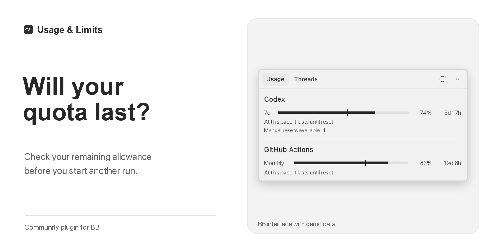
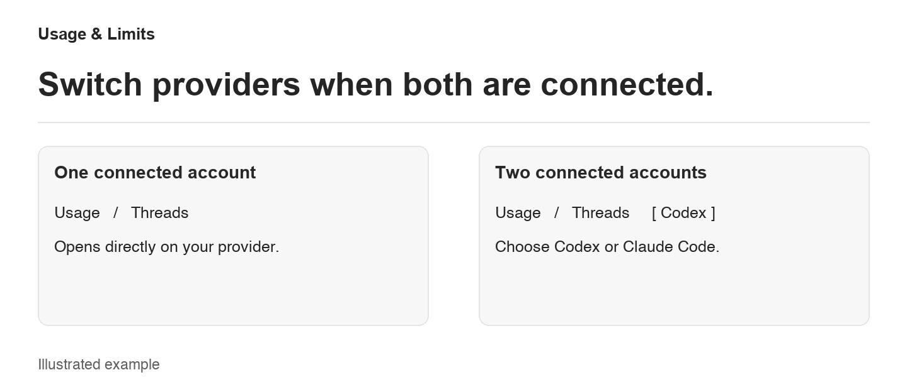
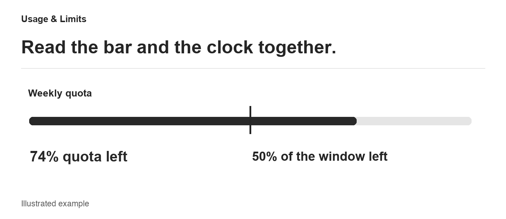
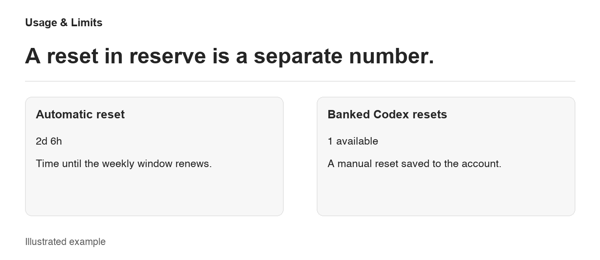
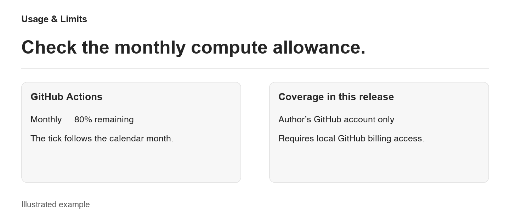
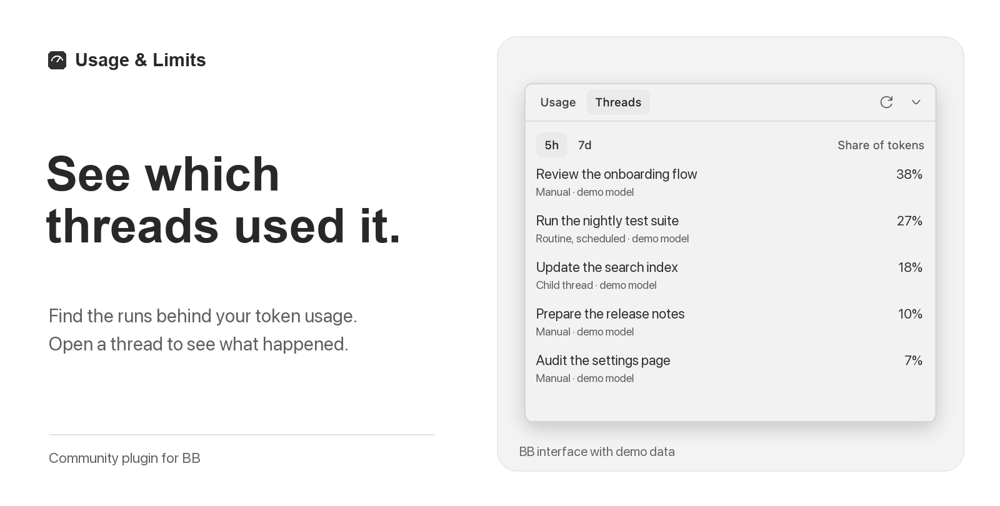
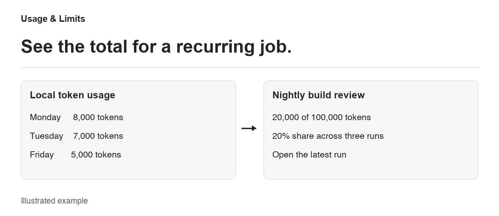

# Usage & Limits



Before starting a long run, open **Usage** in the BB sidebar. See how much quota you have left and whether it will last until the window resets. If it is going faster than expected, switch to **Threads** to find the work behind it.

In the demo, the weekly allowance falls from 74% to 68%. Switching to Threads reveals that release review accounts for 48% of locally observed tokens.

## Install

```sh
bb plugin install git:https://github.com/startsevdev/bb-plugin-usage-and-limits.git@v0.1.4
```

Open **Usage & Limits** at the bottom of the sidebar. One connected provider opens directly. When both Codex and Claude Code report usage to BB, the selector beside **Usage** and **Threads** switches between them.



## Read your next run at a glance

| In the Usage tab | What it tells you |
| --- | --- |
| Remaining bar | The percentage of your provider allowance still available. Each reported five-hour or weekly window has its own row. |
| Pace marker | How much of the window is left in time. When the fill extends past the marker, more quota remains than time. |
| Forecast | Whether your recent pace will carry you to the reset. A weekly estimate needs enough observed history. |
| Manual resets available | The number of banked resets reported by Codex for the matching account. A missing balance reads **Unavailable**. |





**GitHub Actions** has a separate monthly compute row. In this release, that integration is tied to the author’s GitHub account and requires its authenticated GitHub CLI. The Codex and Claude Code views use your own provider data.



## Find the thread behind the spike



Pick **5h** or **7d**. The list ranks threads by their share of observed tokens and identifies manual work, routines and child threads. Repeated runs of the same routine roll up into one row, so a nightly job is easy to spot even when no single run was large. Rows show the model and subagent count when available. Open a routine to inspect its latest run, or open a linked thread directly. A high share tells you where local token use went. Subscription quota is measured separately by the provider.



## Where the numbers come from

- **Quota** comes from BB’s provider usage API. The plug-in reads the Codex manual reset balance through the local Codex app server. Claude Code’s connector supplies quota windows but does not expose a manual reset count.
- **Thread shares** come from local Codex session logs and Claude Code project logs, including input, output and cache tokens. Activity on other machines and ChatGPT web conversations can fall outside that view.
- **Freshness** is checked on a five-minute cache. After an unsuccessful quota check, the card can show the last confirmed percentage with its observation time.

<details>
<summary>Forecast calculations, data coverage and CLI commands</summary>

Weekly forecasts use real quota usage over the rolling last 7 days,
including nights, idle time and usage before the latest weekly reset.
Provider percentage snapshots are persisted across reloads; existing Codex
rate-limit events backfill history immediately, including observations with
null token info. At scheduled or early subscription resets, only observed quota consumption is added across
windows; unused allowance is never counted as spend. Small timestamp jitter
and repeated/corrected readings do not count twice. The 7-day boundary is
interpolated between observations, so the pace remains an estimate.
When there is no history covering the last 7 days, the widget says so;
it does not impose a new waiting period after each weekly reset.
Five-hour forecasts continue to estimate the recent working pace.

A black tick (white in dark mode) on each Codex and GitHub Actions bar marks the remaining fraction of its time
window, using the same direction as the remaining allowance. After one day of
a weekly window it sits one seventh of the bar's width from the right edge.
If the allowance ends to the right of the tick, more quota remains than time;
if it ends to the left, quota is being used faster than the window elapses.
The tick is 1px wide and three times the bar's height, centred vertically.
The moving end of the filled allowance bar is square for precise comparison.
The Actions tick follows its actual UTC calendar month, including short months.

Usage checks have a five-minute TTL. Quota history stays local and is isolated
by the provider's plan label; the weekly provider history retains 8 days (7 days plus an interpolation anchor).
If provider checks fail, the last
successful result stays visible with its timestamp.

```sh
bb where-the-limit-goes report 5h --provider codex --json
bb where-the-limit-goes report 7d --all
npm test
npm run typecheck
bb plugin build
bb plugin reload where-the-limit-goes
```

</details>
